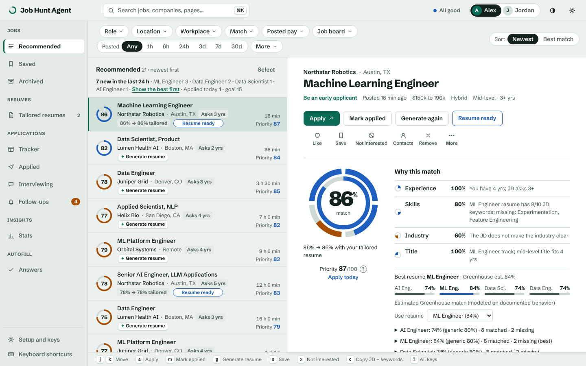
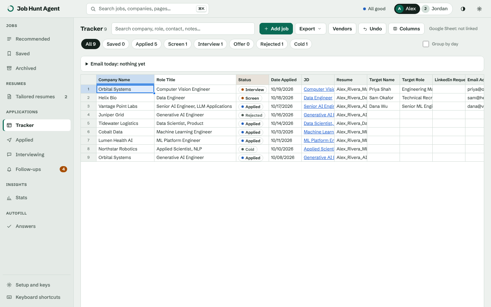
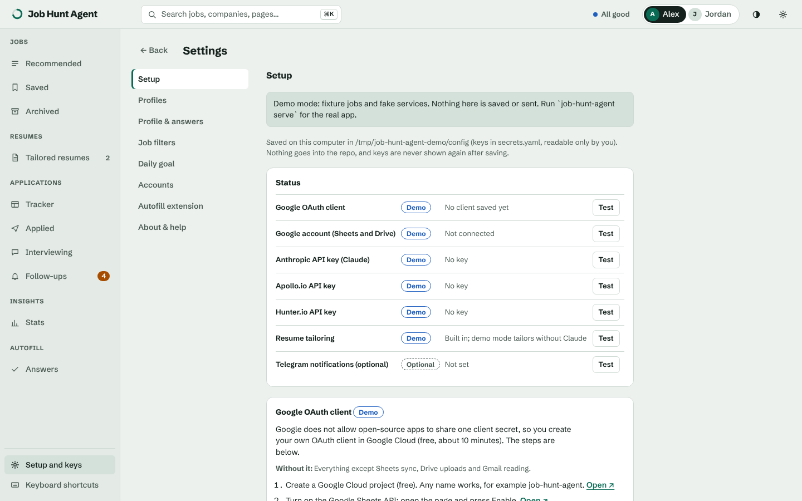
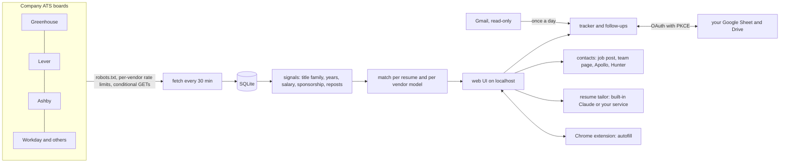

# job-hunt-agent

Built in October 2026 for my own job search. This is the public version, with my personal profiles and keys removed.

A local app that pulls fresh AI and ML job postings straight from company applicant tracking systems (Greenhouse, Lever, Ashby, Workday and about 25 others), ranks them by how well the job description fits your resume, and keeps track of everything after you apply: a tracker that looks like a spreadsheet, applications grouped by day, follow-ups, contacts, outreach drafts and tailored resumes. It runs on your own computer with SQLite and a small web UI. There is no server of mine in the middle.



## Why I built it

My partner and I were job hunting at the same time. The aggregator sites kept showing us roles that had been posted weeks earlier, reposted, or already filled, and their "match" scores were keyword counts that rewarded stuffing. Most of the good roles were on company career pages hours before they showed up anywhere else, and applying in the first day or two clearly mattered.

So I wrote something that reads the company boards directly every 30 minutes, keeps only US AI, ML and data roles, and sorts them by an actual fit score against each of our resumes. Then it grew the parts we kept doing by hand: a tracker that matched the Google Sheet we already used, follow-up reminders, finding a recruiter or hiring manager to write to, and a tailored resume per job. We used it every day. The version here supports any number of profiles, or just one.

## What it does

- Fetches postings from about 400 curated company boards and roughly 24,000 discovered ones (from the Common Crawl index, the S&P 500 and H-1B filings). It is polite about it: robots.txt is checked on every request, each ATS vendor gets its own rate limit, and boards are polled every 30 minutes, every 4 hours or daily depending on how often they post matching roles.
- Scores every job against every resume in a profile. The match is built from experience, hard skills (a curated lexicon with aliases, so "LLMs" counts as LLM), industry and title. A separate priority score adds freshness, real requisition signals (a named team, posted pay) and seniority, and penalizes reposts, evergreen "talent pool" postings and clearance requirements.
- Shows for each job how its ATS vendor is documented to treat resumes (parsing pitfalls, keyword search versus AI matching, knockout questions), with a citation for every claim, and estimates your match under that vendor's model.
- Tracks applications. Mark applied stamps the date and the resume you used, the Applied view can group cards by day, Follow-ups lists who to write to today, and Stats shows response rates. Optional two-way sync with your existing Google Sheet, and Excel export in your own layout.
- Finds people to contact for an application: names in the job post, the company's team page, then Apollo and Hunter on a click, with the credit cost shown first. It drafts a cold email and a LinkedIn note for a recruiter, the hiring manager or a peer, either as a plain template or written by Claude with your own key. It never sends anything.
- Tailors a resume to one job, with the built-in tailor (Claude, your key) or through your own resume service. The built-in one may only reword and reorder, and its output is forced back into the shape of your base resume: same jobs, same bullet counts, same skills.
- Reads your job-application inbox once a day (read-only Gmail, or IMAP) and moves an application to rejected, screen or interview only when it is sure which application the email is about. Everything else waits for you.
- Ships a Chrome extension (`extension/`) that fills application forms on Workday, Greenhouse, Lever, Ashby and others from your saved answers and the tailored resume. It never presses Submit.

| Tracker | Settings > Setup |
|---|---|
|  |  |

## Try it in two minutes, no keys

```sh
git clone https://github.com/vijayyarabolu/job-hunt-agent.git
cd job-hunt-agent
python3 -m venv .venv && .venv/bin/pip install -e .
.venv/bin/job-hunt-agent demo --open
```

Demo mode starts the real app on fictional data: two sample profiles (Alex Rivera with four resumes, Jordan Lee with one), about 25 made-up postings, a tracker with a few weeks of history and two tailored resumes. Every outside service is replaced by a fake, so nothing is sent anywhere. You need Python 3.11 or newer.

## Use it for real

```sh
.venv/bin/job-hunt-agent serve
```

Open http://localhost:8765. On the first run the app opens Settings > Profiles:

1. Add a profile: your name, the roles you want, years of experience. Add another if someone else is searching too.
2. Upload your resume as a Word .docx. Headings named Summary, Skills and Work Experience, with bullets as a Word list, read best. A profile can also have one resume per target role (the `resumes:` list in its profile.yaml; the sample profile in `job_hunt_agent/sample.py` shows the format).
3. Open Settings > Setup. Its status panel lists every account and key as Connected, Missing or Failing, with a Test button for each. None of them is required, and each one says what works without it.

The first fetch starts with the server and takes a few minutes. `job-hunt-agent fetch` runs one from a terminal, and `job-hunt-agent doctor` shows the health of every board.

Everything you enter is stored in `~/.job-hunt-agent/` (or wherever `JOB_HUNT_AGENT_HOME` points): the SQLite database, your profiles and resumes, tokens, and `config/secrets.yaml` for keys, written with owner-only permissions. None of it lives in the repo.

### Connecting accounts

Google (Sheets, Drive, Gmail) uses a normal sign-in: OAuth 2.0 authorization code with PKCE, redirected back to the app's own port, with the minimum scopes. Those are edit access to spreadsheets (your tracker sheet), `drive.file` (only files the app creates), and `gmail.readonly` if you turn on email reading. Tokens refresh on their own, and Disconnect revokes the token at Google and deletes it locally.

Google does not allow an open-source app to ship a shared client secret, so you create your own OAuth client once. Settings > Setup walks through it with a link to each Cloud Console page: make a free project, enable the Sheets and Drive APIs, set the consent screen to External and publish it (personal apps with fewer than 100 users need no review), add the scopes, and create a Desktop app client. Paste its client ID and secret, or the downloaded JSON, into the form and press Connect Google. Google will warn that it hasn't verified the app, which is expected for your own client. The whole thing takes about 10 minutes.

Anthropic, Apollo and Hunter have no sign-in for third-party apps, so each takes an API key pasted into Setup:

| Service | Used for | Where to get a key | Cost |
|---|---|---|---|
| Anthropic (Claude) | built-in resume tailoring, reading job emails, one-click outreach drafts | [platform.claude.com](https://platform.claude.com/settings/keys), Settings, API keys | Pay per use. The app uses Claude Sonnet 5.5 at $2 per million input tokens and $10 per million output tokens ([claude.com/pricing](https://claude.com/pricing), checked October 2026). |
| Apollo.io | the company and its senior people, for outreach | Apollo, Settings, Integrations, API | The free plan has a small monthly credit allowance (about 75 credits when I checked); paid plans start around $49 a month ([apollo.io/pricing](https://www.apollo.io/pricing)). The app spends 1 credit per company and asks first. |
| Hunter.io | email addresses at a company domain | [hunter.io/api-keys](https://hunter.io/api-keys) | The free plan has 50 credits a month at the time of writing; Starter is about $49 a month billed monthly ([hunter.io/pricing](https://hunter.io/pricing)). One domain search costs at most 1 credit here. |
| Telegram (optional) | phone notifications for strong new matches | @BotFather | Free |

What a month of normal use costs: tailoring 30 resumes is about 30 calls of roughly 3,000 tokens in and 3,000 out, around $1. Reading 300 job emails in batches of 15 is about 20 calls, another $1 or so. Outreach drafts are under a cent each. So expect $2 to $5 a month for Claude, and nothing for Apollo and Hunter if you stay on their free plans. Fetching, ranking, the tracker, Google sync and the extension cost nothing.

Without an Anthropic key everything else still works. Copy JD + keywords puts the job and the skills you are missing on the clipboard for your own Claude chat, and the outreach dialog gives you a ready-made prompt and a plain template. If the Claude Code CLI is signed in on your computer, the email reader can use it instead of a key.

To use your own resume-tailoring service instead of the built-in one, put its URL (and a token, if it needs one) in Setup. It has to answer the small JSON API described at the top of `job_hunt_agent/tailor.py`.

## How it works



The server is the standard library's `http.server` with a few background threads: the fetch loop, the Google Sheet sync, the daily email check and the morning digest. Each ATS has one small fetcher module in `job_hunt_agent/ats/`. Scores are computed in Python from cached JD keywords, so a feed of a few thousand jobs answers in well under a second. The UI is plain ES modules with no build step. `docs/design.md` explains the main design choices.

## Platform notes and extra setup

- It runs on macOS and Linux. Windows is untested (the fetch lock uses `fcntl`).
- Only on a Mac: desktop notifications, and the IMAP fallback for email, which keeps the app password in the macOS Keychain. On Linux, use the Gmail sign-in, and Telegram for notifications.
- The autofill extension is loaded unpacked in Chrome (Settings > Autofill extension has the steps). Its self-check (`job-hunt-agent autofill canary`) and the H-1B data refresh drive Chrome through Node and expect Chrome at the macOS path.
- `job-hunt-agent serve --lan` lets a second laptop or a phone on the same network use the app, behind a token.

## Development

```sh
python -m unittest discover -s tests -t .
```

About 1,560 tests, all offline: Google is a local fake server, ATS answers are saved fixtures and Claude is stubbed. The browser tests (the extension against saved application forms, the UI in headless Chrome) skip themselves unless Node and Chrome are present. CI runs the suite on Ubuntu, plus an offline eval of the email rules on 54 labelled emails.

## Limitations

- US roles only, and only AI, ML, data science and data engineering titles. Other fields need new title patterns in `job_hunt_agent/titles.py` and lexicon entries.
- Some big employers (Google, Apple, Meta, Tesla) have no public posting API that allows fetching, so they are not covered.
- The vendor match is an estimate built from each vendor's public documentation. Employers configure their ATS in ways nobody outside can see.
- The built-in tailor makes a clean .docx and a plain PDF, not a designed resume.
- Because each user runs their own OAuth client, Google's sign-in shows the "unverified app" warning.

## License

MIT, see `LICENSE`.
